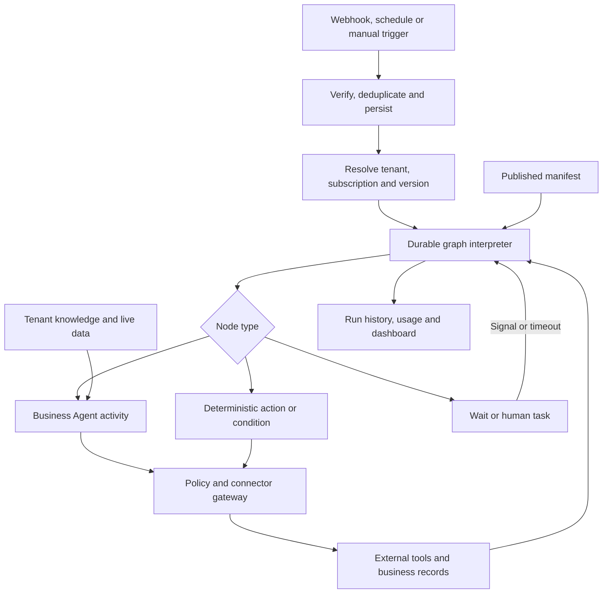

# SuperAgent Architecture

Version 4.0 · 17 November 2026 · Proposed target architecture

## 1. Product purpose

A shop owner can ask SuperAgent in Darija, “جاوب الزبناء فالواتساب، وملي يأكدو طلبية بالدفع عند الاستلام، سجّلها فـ Google Sheets.” On the React website or Flutter mobile app, the owner reviews a sample reply and spreadsheet row, approves the plan, connects their accounts and publishes. The dashboard then shows what the assistant sent and what happened to each order.

SuperAgent serves people without development experience. Clients describe goals, review examples and choose accounts in Darija or French. Platform admins maintain a catalog of ready-made workflow scenarios. The AI Builder selects a released scenario and adapts its system instructions, task prompts, fields and permitted options to the business. The backend owns the executable steps. If no scenario fits, the Builder explains the gap and records the request for admin review.

## 2. Two AI roles and one execution backend

| Component | Responsibility | Output |
|---|---|---|
| Agent Builder | Understand the business, clarify goals, select capabilities and propose the workflow | Business specification, agent configuration and graph draft |
| Workflow compiler | Validate graph structure, types, permissions, bindings and limits | Validated execution manifest or actionable errors |
| Business Agent | Perform contextual reasoning inside a published workflow: understand messages, retrieve information and propose permitted actions | Typed result or permitted tool request |
| Execution backend | Persist state, route events, invoke nodes, enforce policy and recover failures | Completed operations and traceable run history |

These AI roles are logical responsibilities and may use the same model provider. They do not require a fleet of independently collaborating agents.

A Business Agent operates within the published manifest. A request to change its tools, goals or topology creates a new Builder draft. Runtime conversations cannot silently edit the published workflow.

## 3. Architecture

### 3.1 Design and publication

```mermaid
flowchart TD
    U["Business profile and setup chat"] --> B["Agent Builder"]
    P["Profile, knowledge and connection metadata"] --> B
    C["Released scenario catalog"] --> B
    B --> S["Business specification and graph draft"]
    S --> V["Compiler and binding resolver"]
    V --> D{"Ready to test?"}
    D -->|Missing details or unsupported tools| B
    D -->|Valid| T["Simulation and plain-language preview"]
    T --> A["Client approves revision"]
    A --> Cn["Connect accounts and choose destinations"]
    Cn --> Pub["Client publishes"] 
    Pub --> M["Immutable execution manifest"]
```

The backend builds workflows by compiling graph data into executable manifests interpreted by a shared runtime. Creating a client workflow does not require deploying a new application or executing arbitrary model-generated code.

### 3.2 Runtime

The interpreter persists progress and schedules ready nodes. Agent inference and external calls execute as activities. Persist their results so replay does not repeat model decisions or side effects unnecessarily.

Use a modular backend with separately deployed workers. PostgreSQL holds application metadata and business records, object storage holds files, and a vault holds credentials. The durable engine owns execution state; dashboard run records are linked projections.

## 4. Client experience and generation pipeline

1. **Describe the business and goal.** Save language, products, working hours and policies in the business profile. Ask questions that affect the result, such as what counts as a confirmed order.
2. **Prepare a draft.** Match the goal against released scenarios. Pin the scenario version, fill its declared parameters and generate scoped system and task prompts. Ask the owner for missing business facts.
3. **Review and approve.** Simulate with sample data and mocked connectors. Show the trigger, an example reply, the fields to be saved, handoff rules and required services in plain language. The owner can request changes or approve the exact draft revision on either device.
4. **Connect accounts.** Show one setup card per required service. For a COD workflow, the owner connects a WhatsApp Business number and selects the Google spreadsheet and tab. Request email access when the scenario uses email. Save progress so a cancelled connection can be resumed.
5. **Publish.** Express checks membership, approved revision, capability versions, account ownership, destination fields and access. Show the actual number and destination for final confirmation. Record the immutable manifest and subscription intent atomically. Show “Activating” until routing is ready, then mark it active. Retrying publication of the same revision and bindings reuses the activation.
6. **Monitor and edit.** Open the inbox or results dashboard. Editing a live workflow creates a new draft. A change to prompts, rules, fields or effects invalidates draft approval. Existing runs finish on their pinned version. Pause stops new runs. Rollback redirects future runs to a previously published, eligible version.

Draft review, connection health and deployment status are separate records. An approved draft can wait for a connection. A failed replacement deployment leaves the previous version serving until the new routing is ready.

### 4.1 Admin workflow studio

In the React admin console, a platform admin chooses **Add workflow**, gives the scenario a client-facing name and describes the requests it matches. The editor lets them choose registered triggers and actions, connect branches, define required fields and connector slots, and supply default prompts with named customization fields.

Save as draft, run the compiler and fixtures, then release an immutable scenario version to the catalog. For the COD scenario, fixtures cover confirmation, refusal, missing address and an unavailable sheet. Failed validation identifies the step to fix. A new provider action requires a registered backend adapter before it appears in the editor.

Admins can clone a release, edit the copy and retire an older release from new selection. A catalog release makes a scenario available to the Builder. Client publication activates one tenant’s configured instance. Existing deployments retain their pinned versions. Catalog writes require a platform-admin role and record the actor, revision and test results.

## 5. Capabilities, compiler and generated artifacts

### 5.1 Reusable node catalog

| Node family | Examples | Backend contract |
|---|---|---|
| Trigger | Message received, schedule, manual request | Verified event schema and tenant-bound subscription |
| Agent | Classify intent, extract details, draft an answer | Structured outputs, allowed tools and inference budget |
| Knowledge | Retrieve company policy, look up a product | Tenant-scoped query and source references |
| Action | Save lead, send message, update sheet, notify employee | Typed inputs, connection reference and idempotency policy |
| Control | Condition, parallel split, join, bounded iteration | Explicit branch and completion semantics |
| Wait | Wait for customer reply or approval | Correlation key, deadline and timeout route |
| End | Complete, escalate or stop | Explicit final state and reason |

Each capability declares a stable name/version, schemas, required scopes, connection type, risk category, timeout, retry classification, idempotency support, implementation reference and fixtures.

Each scenario pins a graph and declares the branches and settings the Builder may customize. Unsupported capabilities require developer implementation and registration before a client can activate them. Catalog extensions are a separate development process.

### 5.2 Generated artifacts

| Artifact | Contents |
|---|---|
| BusinessSpec | Goal, trigger, entities, required fields, constraints and unresolved questions |
| AgentConfig | Role, language, instructions, knowledge scope, allowed tools, output schema and limits |
| WorkflowDraft | Nodes, edges, data bindings, conditions and connection requirements |
| ValidationReport | Errors/warnings with node IDs, missing permissions and remediation |
| ExecutionManifest | Resolved capability versions, connection IDs, policy version and immutable graph |
| SimulationReport | Fixture inputs, traversed paths, expected effects and test results |

Keep these artifacts distinct. Instructions alone are not an executable workflow.

### 5.3 Compiler checks

- Reject unknown node types, unsupported capability versions and duplicate IDs.
- Validate typed input/output bindings and references; reject unavailable upstream values.
- Require reachable terminal routes, explicit default/error branches and join semantics.
- Reject arbitrary cycles; use bounded iteration nodes and explicit wait/resume constructs.
- During preview, validate connector slots against mock schemas. At publication, verify that each bound account belongs to the tenant and grants the required scopes.
- Resolve required business data and reject unresolved placeholders at activation.
- Enforce action policies, model/tool budgets, timeouts and loop limits.
- Resolve event subscriptions and detect unintended overlapping triggers. Require explicit fan-out or priority rules when multiple workflows match.
- Validate builder output against a schema. Allow a bounded repair loop using compiler errors; unresolved errors return to the client/developer rather than looping forever.

### 5.4 Worked scenario — WhatsApp cash-on-delivery orders

| Step | Decision and observable result |
|---|---|
| Receive | Match the incoming message to the tenant’s WhatsApp number. Resume the open order conversation when present. |
| Reply | Answer product or delivery questions using the shop’s catalog and policies. Record the outbound message, author and delivery status. |
| Collect | When the customer wants to order, open an order attempt. Extract item, quantity, recipient, phone and address. Ask for missing fields and present a summary with the COD amount. |
| Decide | Explicit confirmation of the summary creates one confirmed COD order. Refusal closes the attempt as declined. An ambiguous answer stays pending or goes to staff. |
| Sync | Write the stable order ID, confirmed details, amount in MAD and COD status to the selected tab. Track sheet sync separately so a failed write can be recovered without creating another order. |

The shop owner sees a sample exchange and row before approval. Confirmation measures purchase intent. Delivery and cash collection require separate evidence from staff or a fulfillment system.

## 6. Business knowledge service

Store tenant-specific FAQs, delivery policies, return policies and product documentation. Each document and retrieved passage carries tenant identity, source, version, access rules and update time.

Apply tenant and access restrictions before retrieval. Return source references with answers so operators can inspect their basis. Support reindexing and deletion when documents change.

Use live tools for stock, current prices and order status. Retrieved prose is not the authoritative source for transactional facts. If evidence is missing or contradictory, ask a clarifying question or hand off.

Treat uploaded documents, retrieved text and incoming messages as untrusted data. They cannot grant permissions or override action policy. Limit the context and tools available to each task. [2][3]

## 7. Conversation state and human takeover

Track conversation ownership explicitly: `AI_ACTIVE`, `HUMAN_ACTIVE`, `PAUSED` or `CLOSED`.

- Serialize processing per conversation and define handling for late or out-of-order events.
- Store channel message IDs and message delivery state.
- When an employee takes over, pause AI replies and invalidate pending automated sends.
- Recheck ownership immediately before sending; use a conversation revision or lease to detect stale work.
- Resume automation explicitly and record the transition in the audit trail.
- Keep cross-channel identity linking explicit; do not merge customers solely because their display names match.

## 8. Event intake and durable execution

1. Verify provider signatures and resolve the tenant from a trusted connection mapping.
2. Deduplicate by provider, connection and event ID.
3. Persist the event and outbox record in one database transaction.
4. Acknowledge intake after durable persistence.
5. Dispatch to the conversation processor and start or signal the appropriate workflow.
6. Execute approved skills with persisted step outcomes and external operation IDs.

Keep model calls and external API calls in activities outside deterministic workflow logic. Bound retries by total duration, not only attempt count. Retry transient failures with backoff and jitter; pause permanent authorization failures. Quarantine exhausted work for review. Temporal documents retry policies and the possibility of activity re-execution. [1]

### Idempotency and uncertain outcomes

Business deduplication must survive workflow upgrades. Use a stable operation key based on tenant, source event and logical business action, adding a stable target identifier if an event produces multiple actions. Do not use workflow version as the sole distinction for the same business operation.

Track workflow version separately for provenance. Persist operation state and external IDs. Use provider idempotency keys where available; otherwise reconcile the external result before retrying an ambiguous timeout. If reconciliation is impossible, mark the result uncertain and route it to an operator.

Durable execution does not guarantee exactly-once external effects. Intentional repetition must create a new explicit business operation, rather than silently bypassing deduplication.

## 9. Connector gateway and channel policies

The gateway resolves secret references, checks tenant ownership and permissions, enforces provider limits and normalizes results.

Each channel adapter owns messaging rules, template support, connection status and delivery webhooks. Check current provider requirements during implementation and keep them versioned in code/configuration. Meta's official examples cover templates, webhooks and media messages. [4]

Express owns provider callbacks and binds each authorization attempt to the initiating user, tenant and connector slot. Use Google OAuth for Sheets and, when requested, Gmail. Use guided Meta WhatsApp Business onboarding to select the business account and phone number. The platform team maintains the provider app configuration. Flutter opens the hosted authorization flow in the system browser and reloads status from Express on return. Store provider identifiers and vault references server-side. Signing in to SuperAgent and granting access to business tools are separate steps.

Expose account reconnection and affected-run recovery in the dashboard. Token refresh should be bounded and coordinated to prevent parallel refresh races.

## 10. Core data model

| Entity | Key relationships and purpose |
|---|---|
| Tenant / Membership | Business boundary, users and roles |
| BusinessProfile / BusinessSpec | Company context, goals, constraints and requirement revisions |
| Scenario / ScenarioVersion | Platform catalog entry, release state, tested graph, prompt defaults, editable schema and connector slots |
| OrderAttempt | Tenant, conversation, current decision and optional confirmed order ID |
| BuilderSession / DraftRevision | Setup conversation, generated drafts and revision history |
| CapabilityVersion / AgentConfig | Executable catalog contracts and scoped AI behavior |
| ValidationReport / SimulationReport | Compilation findings and pre-publication results |
| TriggerSubscription / WaitCorrelation | Event routing, published versions and resumable waits |
| Connection | Tenant, provider account, scopes, health and secret reference |
| Customer / Conversation / Message | Tenant, channel identities, ownership and message history |
| Order | Tenant, customer, validated business fields and operation key |
| KnowledgeDocument / Passage | Tenant, source, version, access rules and retrieval data |
| Workflow / WorkflowVersion | Tenant instance, pinned scenario, approved revision, resolved prompts and immutable manifests |
| Run / StepExecution | Version, event, status, attempt history and external IDs |
| Event / Outbox | Durable intake and dispatch |
| BusinessOperation | Stable deduplication key and effect outcome |
| Approval / AuditEvent | Action decisions and attributable changes |
| UsageEntry | Tenant, run, usage category, quantity and cost basis |
| EvaluationCase / EvaluationRun | Fixtures, expected outcomes and release results |

Use PostgreSQL as the source of truth for platform-owned business records; Sheets is a synchronized projection. Enforce tenant scope in queries and row-level policies. Runtime roles must not bypass those policies; privileged maintenance paths need separate controls. Test cross-tenant denial. [2]

## 11. Access and action controls

- Resolve tenant identity from authenticated sessions or verified connection mappings.
- Recheck ownership and authorization at the tool boundary.
- Store encrypted credentials in a vault; expose only references to the model.
- Enforce tool allowlists, typed arguments and quotas in backend code.
- Require review for destructive actions and advertising spend changes by default.
- Bind approval to the exact proposed action and parameters; changed parameters require a fresh decision.
- Configure retention, deletion and backup recovery for business data and logs.

## 12. Usage, budgets and observability

Track model usage, connector operations and estimated/actual cost per tenant and run. Check budgets before work, reserve estimated usage for concurrent requests and reconcile actual usage afterward. Handle failed and cancelled operations explicitly.

Propagate one correlation ID across intake, model calls, workflow steps and provider requests. Collect redacted logs, traces and metrics with OpenTelemetry. [5]

Dashboard views should include failed steps, pending approvals, disconnected accounts, uncertain deliveries, usage and workflow versions. Recovery actions resume the affected operation while retaining deduplication history.

### 12.1 Owner dashboard on web and mobile

The inbox shows WhatsApp conversations, AI and staff messages, timestamps, delivery status and handoff ownership. Selecting an order opens its conversation, workflow run and sheet sync status.

Group order attempts by their start date in the business timezone. Count distinct attempts in their current state (pending, confirmed or declined). The confirmation rate is confirmed divided by confirmed plus declined. Show an empty indicator when no decision exists. Label confirmed order value separately from cash collected. Show run failures and sheet sync errors beside the affected records. A spreadsheet outage changes the sync indicator while the confirmed count stays stable.

## 13. AI evaluation and release gates

Maintain separate Builder and Business Agent evaluation suites. For the Builder, measure specification completeness, graph validity, supported-capability selection, correct bindings and successful execution against fixtures. For the Business Agent, start with a proposed set of 100 anonymized representative conversations, including Darija, French, mixed-language input, missing fields and misleading instructions. Keep a held-out regression set.

Measure extraction accuracy, answer grounding, escalation correctness, duplicate actions, latency and cost. Run evaluations whenever prompts, models or skills change. Combine deterministic checks with human review; model grading alone is insufficient for transactional correctness. Agent evaluation tooling supports datasets, traces, graders and evaluation runs. [6]

Choose explicit acceptance thresholds from the initial baseline. Block releases with failed isolation tests or duplicate-order regressions.

## 14. Proposed implementation stack

| Component | Proposed starting choice |
|---|---|
| Web | React and TypeScript for setup, inbox and dashboard, plus a role-gated admin studio |
| Mobile | Flutter and Dart for the full client journey from chat to publication and monitoring |
| API | Node.js with Express.js and TypeScript. Both clients share versioned JSON endpoints and server-side state |
| Business database | PostgreSQL with tenant policies |
| File storage | Object storage |
| Execution | Durable workflow engine such as Temporal |
| Credentials | Managed secret vault |
| AI access | Provider adapter with versioned prompts and model configuration |
| Telemetry | OpenTelemetry and a compatible storage/viewing backend |

PostgreSQL is the proposed primary database because orders, tenants, approvals and workflow versions have explicit relationships. Transactions and unique constraints keep an order and its outgoing sync request consistent. JSONB accommodates scenario parameters and typed model outputs. Confirm hosting requirements, provider access and operational cost before implementation.

## 15. Delivery roadmap

### Phase 1 — One end-to-end COD workflow

Ship the admin editor and release process, business setup chat, scenario matching, prompt customization, simulation, approval and publication. Deliver the React and Flutter client flows against the same Express API. Connect WhatsApp and Google Sheets and verify the inbox, business counts, human takeover and recovery with one shop.

### Phase 2 — Expand the catalog

Add travel lead qualification and service inquiry triage through the admin studio. Add email notifications, version comparisons, rollback and tenant usage controls. Use unsupported requests to prioritize new scenarios.

### Phase 3 — Broader capabilities

Add voice intake after evaluating Darija transcription. Add advertising reporting first, then bounded write actions with explicit permissions and approval rules. Expand the catalog based on unsupported requests collected from real clients.

## 16. Release acceptance criteria

### Generation and customization

- An admin releases a COD scenario and the Builder can select it. Tenant users cannot edit the catalog. Two shops using the same release receive their own prompts, rules and account bindings.
- A client can start on Flutter, review on React and publish from either app. Publication requires current approval and healthy connections for every required slot.
- One confirmed attempt, one refusal and one unresolved attempt show as one confirmed, one declined and one pending, with a 50% confirmation rate. Replaying a webhook preserves those counts.
- Missing details produce focused questions; unsupported tools produce explicit gaps.
- The compiler rejects invalid edges, unbounded loops, missing bindings and unauthorized connections.
- Simulations cover normal, missing-data, timeout and failure paths before publication.
- A chat edit creates a versioned diff; activation cannot publish a stale draft.
- Existing runs retain their published behavior after a new version is activated.

### Runtime and business correctness

- Duplicate events do not duplicate business effects, including across workflow upgrades.
- Customer replies resume the correct waiting run without creating a competing conversation flow.
- An ambiguous external action is reconciled or marked uncertain.
- Human takeover suppresses pending AI replies; resumption is explicit.
- Connection failures pause affected work with a visible recovery path.
- Retrieval and tool execution reject cross-tenant access.
- Every run exposes its manifest version, step history, usage and outcome.
- Builder and Business Agent changes pass separate Darija/French regression suites.
- Backup recovery and tenant deletion procedures are exercised.

## 17. Suggested backend module boundaries

| Module | Responsibility |
|---|---|
| identity | Tenant context, membership and authorization |
| business-profile | Company facts, rules and revisions |
| builder | Setup chat, requirement extraction, scenario matching and prompt customization |
| scenario-catalog | Admin authoring, fixtures, immutable releases, retirement and matching metadata |
| capability-registry | Capability discovery and immutable contracts |
| compiler | Graph/type checking and manifest generation |
| simulator | Fixture execution with mocked effects |
| workflow-management | Drafts, publication, pause and rollback |
| event-router | Intake, subscriptions, deduplication and wait correlation |
| runtime | Durable interpretation, scheduling and activity dispatch |
| agent-runtime | Scoped inference, knowledge retrieval and typed outputs |
| connectors | Credentials, provider adapters and action policies |
| operations | Human inbox, recovery, approvals, usage and traces |

### Shared Express API

| Caller | Representative endpoints | Contract |
|---|---|---|
| Platform admin | POST /v1/admin/scenarios, POST /v1/admin/scenarios/:id/releases | Create a draft or release a tested revision. Record catalog audit history. |
| React or Flutter user | POST /v1/builder/sessions/:id/messages, GET /v1/drafts/:id | Submit a description or correction and retrieve the draft and preview. |
| Tenant owner | POST /v1/drafts/:id/approve, POST /v1/drafts/:id/publish | Check expected revision. Return missing connections or an activation ID. |
| Tenant owner | POST /v1/connections/:provider/start | Start provider authorization and expose connection status to both clients. |
| Tenant staff | GET /v1/conversations/:id/messages, GET /v1/dashboard/outcomes | Return tenant-scoped message history and metrics for the selected period. |

Express resolves permissions for each request. Workers perform inference, connector actions and durable execution outside the request lifecycle.

## 18. Technical references

These sources informed the recommendations in the preceding web-research discussion. Product-specific decisions above remain proposals.

1. [Temporal — Retry policies](https://docs.temporal.io/encyclopedia/retry-policies)
2. [PostgreSQL — Row security policies](https://www.postgresql.org/docs/17/ddl-rowsecurity.html)
3. [OpenAI — Understanding prompt injections](https://openai.com/safety/prompt-injections/)
4. [Meta — WhatsApp Business Platform examples](https://github.com/fbsamples/whatsapp-api-examples)
5. [OpenTelemetry — Signals](https://opentelemetry.io/docs/concepts/signals/)
6. [OpenAI — Evaluate agent workflows](https://developers.openai.com/api/docs/guides/agent-evals)
