<div align="center">

# SuperAgent

**The AI-agent workspace, rebuilt as a mobile-first Flutter app.**
A faithful phone port of the SuperAgent web demo, plus the Phase 1 *WhatsApp cash-on-delivery* flow.


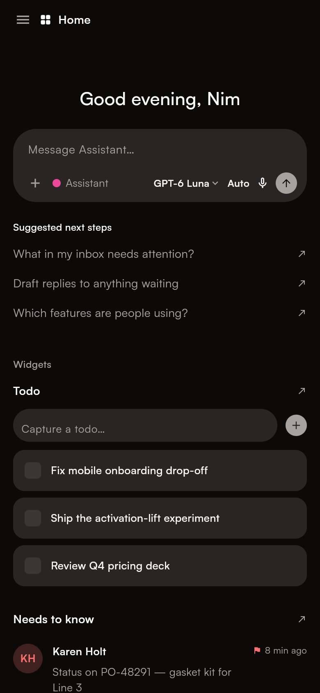
&nbsp;
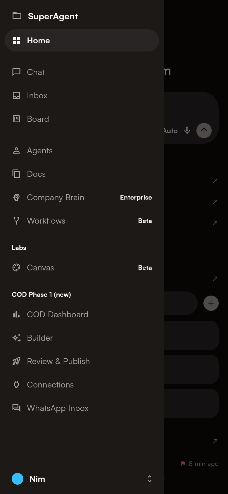
&nbsp;
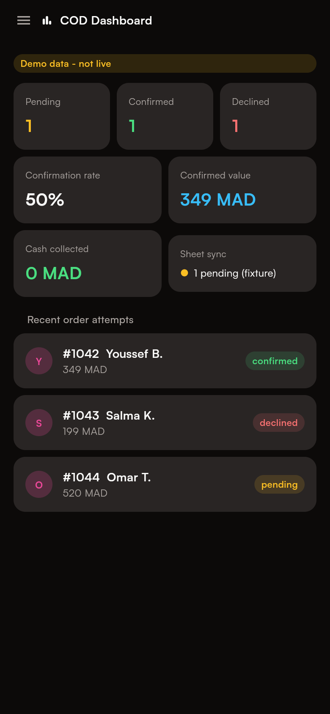

</div>

---

## Highlights

- **9 screens ported from the website** — Home, Chat, Inbox, Board, Agents, Docs, Company Brain, Workflows, Canvas.
- **5 new Phase 1 screens** — COD Dashboard, Builder chat, Review & Publish, Connections, WhatsApp Inbox.
- **Same design language as the site** — dark stone palette, Satoshi + IBM Plex Mono fonts, pill navigation, 10 px radii. Tokens live in one file: [`lib/theme.dart`](lib/theme.dart).
- **Sidebar → drawer.** The website hides its sidebar on phones with no replacement, so the app turns it into a drawer with the same order, grouping, icons and badges. No bottom tab bar.
- **Frontend only.** No network calls, no backend. Every screen reads local demo data and keeps state in memory.
- **One command to run** with Docker.

## Screens

### Ported from the website

| | | |
|:--:|:--:|:--:|
| <br/>**Home** | 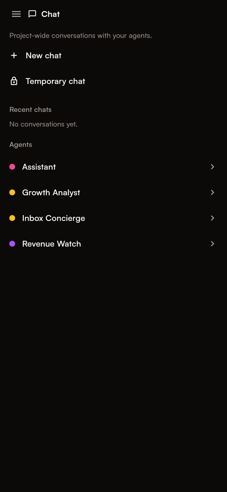<br/>**Chat** | 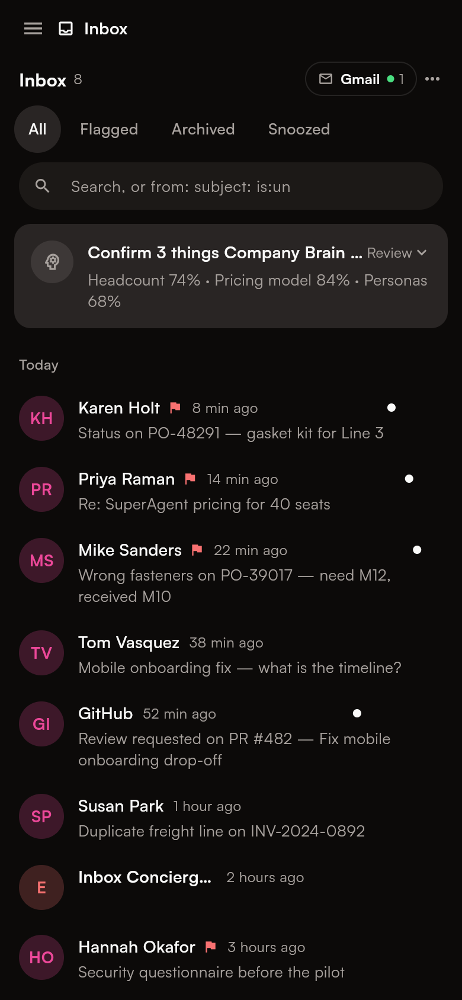<br/>**Inbox** |
| 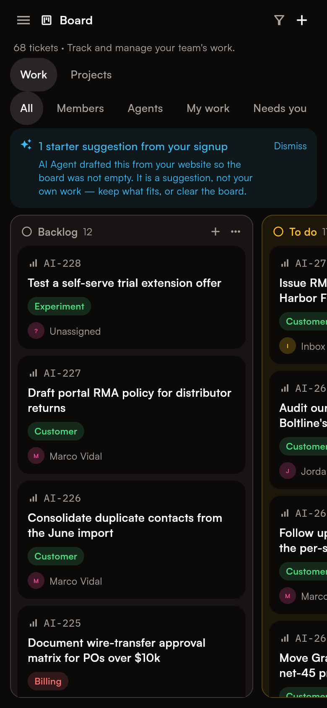<br/>**Board** | 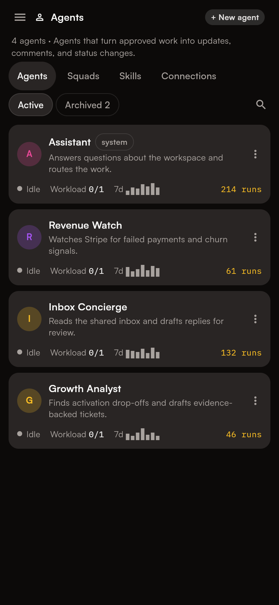<br/>**Agents** | 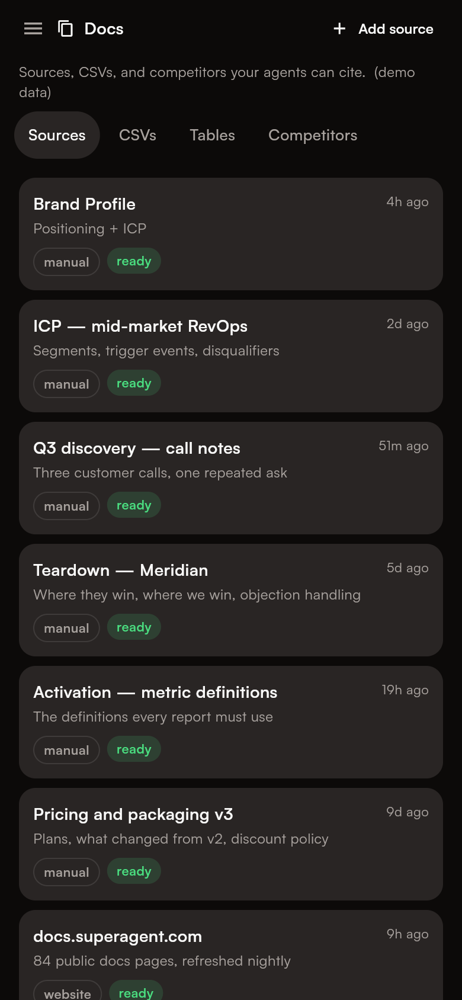<br/>**Docs** |
| 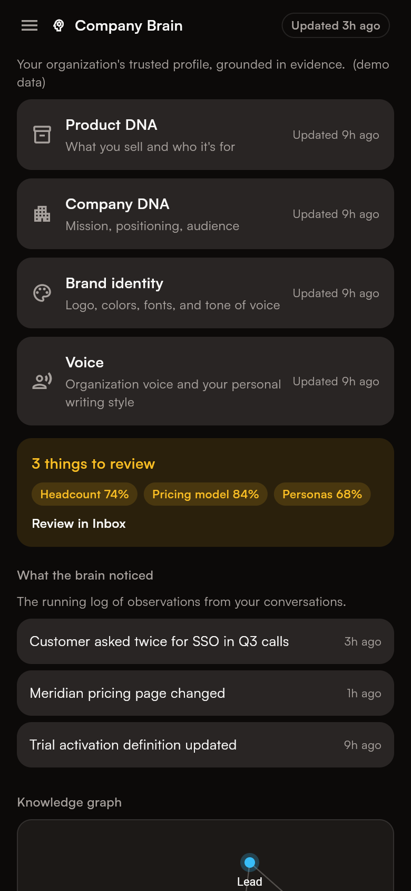<br/>**Company Brain** | 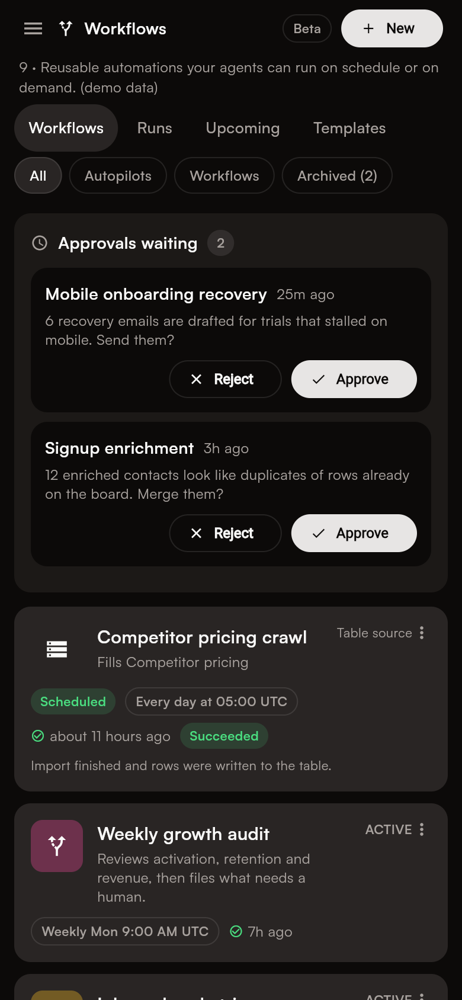<br/>**Workflows** | 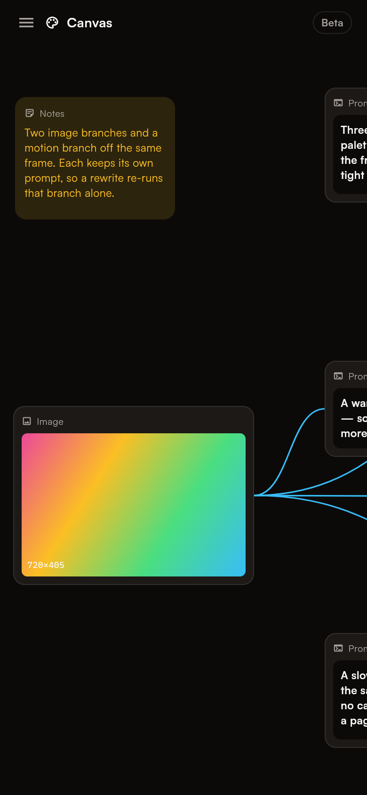<br/>**Canvas** |

### New: COD Phase 1 (WhatsApp + Google Sheets)

| | | | | |
|:--:|:--:|:--:|:--:|:--:|
| <br/>**Dashboard** | 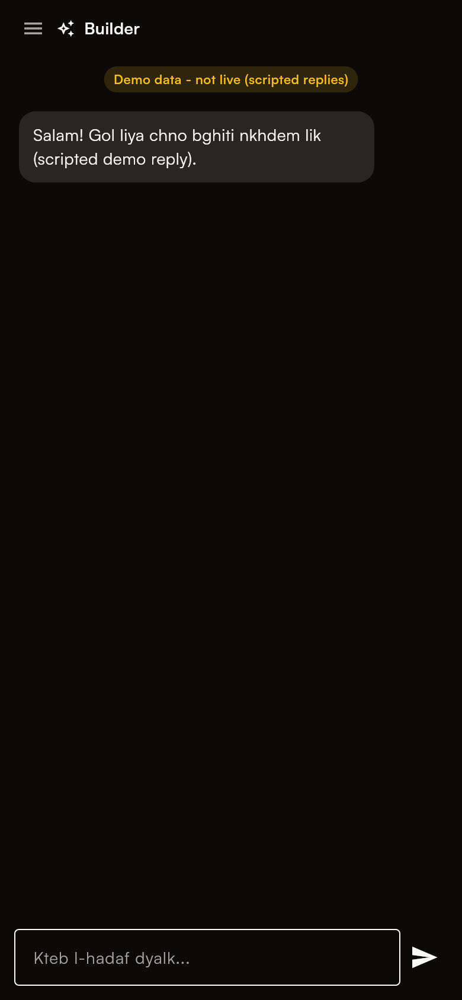<br/>**Builder** | 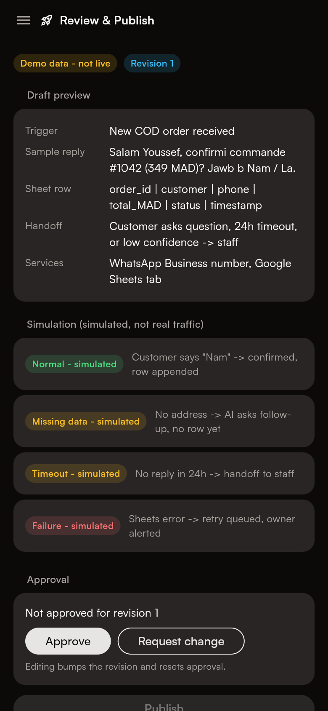<br/>**Review & Publish** | 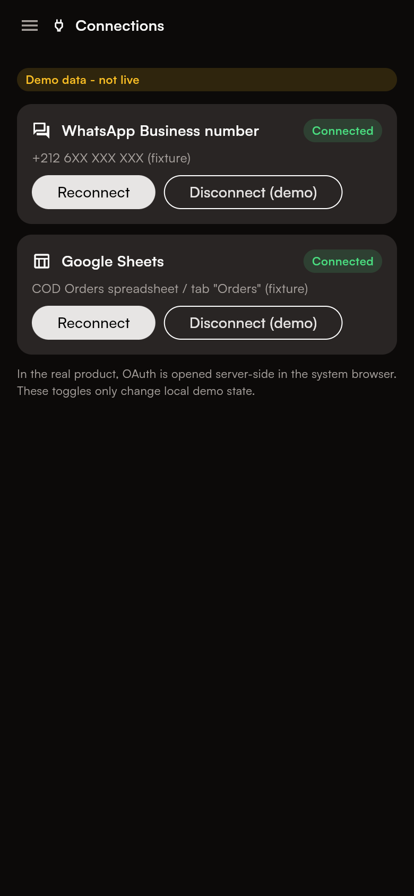<br/>**Connections** | 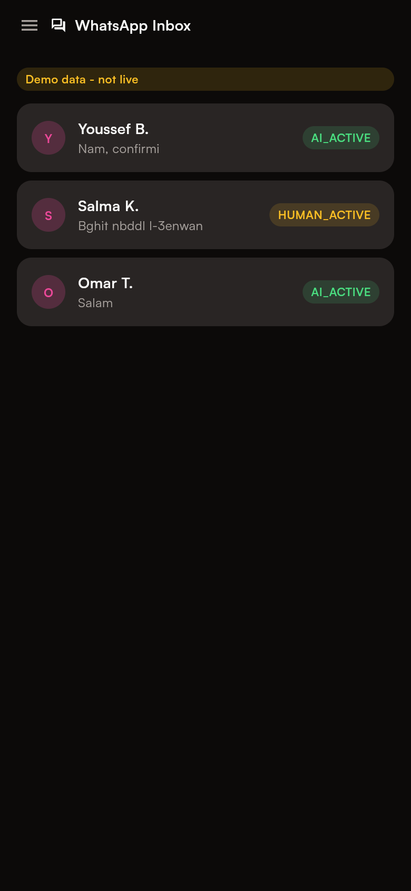<br/>**WhatsApp Inbox** |

What the COD flow shows:

- **Dashboard** — pending / confirmed / declined counts, confirmation rate (`confirmed ÷ (confirmed + declined)`, shown as “–” when there is no decision), confirmed order value kept separate from cash collected, and a sheet-sync indicator.
- **Builder** — describe your goal in Darija, get a matched scenario.
- **Review & Publish** — preview the draft, run simulated cases, approve an exact revision. Editing resets the approval, and Publish stays disabled until it is approved and both connections are healthy.
- **Connections** — WhatsApp Business and Google Sheets setup cards.
- **WhatsApp Inbox** — AI vs staff messages, delivery ticks, and a *Take over / Resume* ownership control.

> Every COD screen is labelled **“Demo data”**. Nothing is connected to WhatsApp, Google or any server.

## Run it

### Docker (easiest)

```bash
docker build -t superagent .
docker run --rm -p 8080:80 superagent
```

Open <http://localhost:8080>. To try it on a phone, connect it to the same Wi-Fi and open `http://<your-computer-ip>:8080`.

The image is a lean two-stage build: Flutter web in a small Debian image, served by nginx (~150 MB). The first build downloads the Flutter SDK, so it can take a while on a slow connection.

### Flutter

```bash
flutter pub get
flutter run -d chrome          # web
flutter run                    # a connected Android device or emulator
flutter build web --release    # static site in build/web
```

An Android build needs the Android SDK and a JDK. An iOS build needs a Mac with Xcode; the iOS project has not been generated.

## Project layout

```
lib/
├─ main.dart            routes + fade page transitions
├─ theme.dart           design tokens, SAPage shell, drawer, shared widgets
├─ screens/             the 9 website screens
└─ cod/                 the 5 COD screens + tiny shared state
assets/fonts/           Satoshi, IBM Plex Mono (converted from the site's WOFF2)
docs/                   project brief, plan, design notes, hand-off, screenshots
Dockerfile, nginx.conf  container build
```

## Design tokens

Taken from the website's compiled CSS (dark theme):

| Token | Value | Use |
|---|---|---|
| `bg` | `#0C0A09` | page background |
| `sidebar` | `#1C1917` | drawer |
| `card` | `#292524` | cards, composer, active nav pill |
| `fg` / `muted` | `#FAFAF9` / `#A8A29E` | text |
| `border` | white @ 10% | hairlines |
| `radius` | 10 px | base corner radius |

## Status and known gaps

What has been checked:

- `flutter analyze` reports no errors.
- The Docker image builds and serves the app; all 15 screenshots above were taken from it at 390 × 844 @2x.

What has **not** been done:

- No side-by-side visual comparison against the original website, and no check at other phone sizes.
- No Android APK build and no run on a real device or emulator.
- No automated tests.
- Some content is approximated rather than copied from the website: Board's *Done* column, the Company Brain graph connections and observation log, the Canvas images (gradient placeholders), and only 20 of the Inbox rows.
- Board's filter tabs are not interactive yet.
- Fonts are converted from the website's WOFF2 files; their licences have not been reviewed.

## Docs

[`docs/PROJECT_BRIEF.md`](docs/PROJECT_BRIEF.md) · [`docs/IMPLEMENTATION_PLAN.md`](docs/IMPLEMENTATION_PLAN.md) · [`docs/DESIGN_REFERENCE.md`](docs/DESIGN_REFERENCE.md) · [`docs/DECISIONS.md`](docs/DECISIONS.md) · [`docs/VERIFICATION.md`](docs/VERIFICATION.md) · [`docs/HANDOFF.md`](docs/HANDOFF.md)
