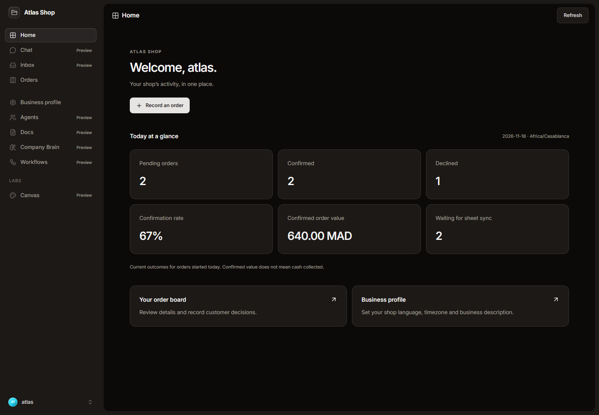
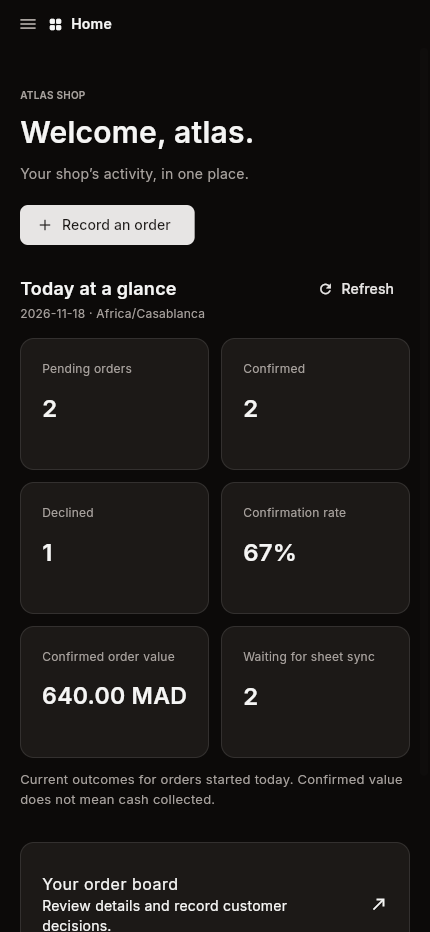
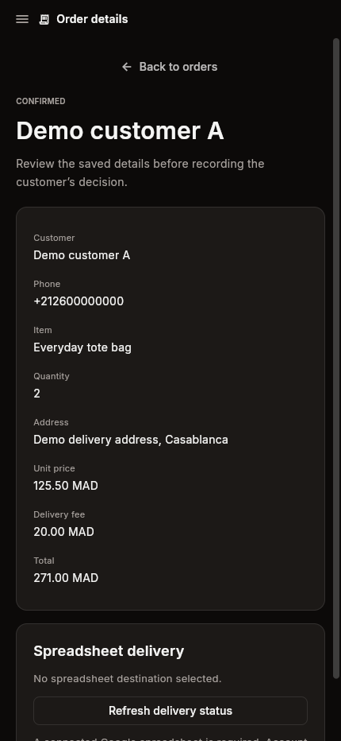

<div align="center">

# SuperAgent

**A shared workspace for Moroccan shops to manage orders, customer decisions, and daily outcomes.**

<p>
  <a href="LICENSE"></a>
  <a href="package.json"></a>
  <a href="backend/package.json"></a>
  <a href="mobile%20flutter/pubspec.yaml"></a>
</p>

[Getting Started](#getting-started) · [Screenshots](#demo--screenshots) · [API Reference](docs/API.md) · [Developer Guide](docs/DEVELOPMENT.md)

</div>

## About

Cash-on-delivery shops need a reliable record of what a customer ordered, what
they confirmed, and what still needs attention. SuperAgent brings those records
into a tenant-scoped workspace with a React web app, a Flutter mobile client,
and a shared TypeScript API.

The connected clients support manual order entry, reviewed customer decisions,
business settings, and daily outcomes. The backend also provides workflow
validation, scenario releases, Builder draft approval, and optional Google Sheets
delivery. These foundations do not yet provide automated WhatsApp intake or a
running Business Agent.

## Contents

- [Key Features](#key-features)
- [Demo / Screenshots](#demo--screenshots)
- [Tech Stack](#tech-stack)
- [Getting Started](#getting-started)
- [Usage](#usage)
- [Project Structure](#project-structure)
- [Roadmap](#roadmap)
- [Contributing](#contributing)
- [License](#license)
- [Contact / Acknowledgments](#contact--acknowledgments)

## Key Features

- 🏪 **Business workspaces** — registration, sign-in, tenant selection, owner/staff access, and business profiles.
- 📦 **COD order management** — manual order entry, integer-centime pricing, saved summaries, and revision-bound customer decisions.
- 📊 **Daily outcomes** — pending, confirmed, and declined counts, confirmation rate, confirmed order value, and outstanding sheet sync.
- 📱 **Connected web and mobile clients** — React workspace plus Flutter Home, Orders, and Business profile screens.
- 📄 **Explicit spreadsheet delivery** — reviewed rows, existing destination selection, queued delivery jobs, and read-only reconciliation of uncertain outcomes; requires Google configuration.
- 🧩 **Workflow API foundation** — versioned capabilities, structural/binding validation, immutable scenario releases, draft simulation, and approval.
- 💬 **Optional AI Builder** — consent-based, queued scenario matching and scoped chat through a separate worker.

The web client retains clearly labelled preview pages. The mobile client exposes
only connected workspace screens. Some backend capabilities, including Builder
and Google account/file setup, do not yet have connected client screens.

## Demo / Screenshots

These are actual local captures using synthetic shop and customer data. Mobile
images show the compiled Flutter web app at a phone viewport, not an Android
device run.

<!-- TODO: Add a public demo URL after a hosted deployment is available. -->

### Web workspace




### Mobile workspace

<p align="center">
  
  
</p>

## Tech Stack

| Layer | Technologies | Location |
| --- | --- | --- |
| Web | React 19, React Router 7, Vite 8, Lucide icons | [`frontend/`](frontend/) |
| Mobile | Flutter, Dart, HTTP client, timezone data | [`mobile flutter/`](mobile%20flutter/) |
| API | Node.js 24+, Express 5, TypeScript 5.9, Zod 4 | [`backend/src/`](backend/src/) |
| Database | PostgreSQL 18, SQL migrations, tenant row policies | [`backend/migrations/`](backend/migrations/) |
| Optional integrations | Google OAuth / Sheets, OpenAI-backed Builder, dedicated workers | [API reference](docs/API.md) |
| Verification | Node test runner, Playwright, Flutter unit/widget tests | [Testing guide](docs/DEVELOPMENT.md#testing-and-verification) |

## Getting Started

### Prerequisites

- **Git**, **Node.js 24 or newer**, and **npm**. The root package declares npm `11.20.0`.
- **Docker with Compose** for the supplied PostgreSQL service.
- **Flutter** for the mobile client. The recorded checks used Flutter `3.47.9` / Dart `3.13.7`; use an SDK compatible with the committed lockfile.
- **Android SDK/JDK and a device or emulator** only when building or running Android. Android APK/device verification is still pending.

No Google or OpenAI credentials are needed for the basic local order workspace.

### Installation

```sh
git clone https://github.com/Oumrane-Echidmi/SuperAgent.git
cd SuperAgent
npm ci
npm --prefix frontend ci --ignore-scripts
cp backend/.env.example backend/.env
```

On PowerShell, `Copy-Item backend/.env.example backend/.env` also works. If script
execution policy blocks npm, use `npm.cmd` in place of `npm`.

Edit `backend/.env` before starting the database. Generate separate random admin
and runtime passwords, then put the matching credentials in both database URLs.
Do not commit real environment files.

### Configuration

The full template is [`backend/.env.example`](backend/.env.example). Backend npm
scripts load `backend/.env`; Docker Compose receives it through `--env-file`.

| Variable | Purpose / local value | Required |
| --- | --- | --- |
| `POSTGRES_PASSWORD` | Password for the local `superagent_admin` database login | Local database |
| `APP_DATABASE_PASSWORD` | Separate password provisioned for the restricted API login | Migrations |
| `ADMIN_DATABASE_URL` | Admin connection to `superagent` on `127.0.0.1:5433`; use the admin password | Migrations |
| `DATABASE_URL` | Restricted `superagent_app` connection to the same database | API |
| `PORT` | API listen port; default `3000` | Optional |
| `BUILDER_AI_ENABLED` | `false` by default; explicitly enables AI Builder processing | Optional feature |
| `BUILDER_AI_MODEL`, `OPENAI_API_KEY` | Model selection and provider credential for the AI Builder worker | AI Builder |
| `BUILDER_WORKER_DATABASE_PASSWORD`, `BUILDER_WORKER_DATABASE_URL` | Separately provisioned Builder worker login; password must be at least 24 characters | AI Builder worker |
| `GOOGLE_CONNECTIONS_ENABLED` | `false` by default; enables Google OAuth connections | Optional feature |
| `GOOGLE_CLIENT_ID`, `GOOGLE_CLIENT_SECRET`, `GOOGLE_REDIRECT_URI` | Google OAuth client and exact registered callback URI | Google connections |
| `CREDENTIAL_ACTIVE_KEY_ID`, `CREDENTIAL_KEYS_JSON` | Active encryption key ID and JSON map of IDs to base64-encoded 32-byte keys | Google connections |
| `SHEETS_DELIVERY_ENABLED` | `false` by default; enables owner-authorized delivery | Sheets delivery |
| `SHEETS_WORKER_ENABLED` | `false` by default; enables the separate background delivery worker | Background delivery |
| `SHEETS_WORKER_DATABASE_PASSWORD`, `SHEETS_WORKER_DATABASE_URL` | Separately provisioned Sheets worker login; password must be at least 24 characters | Background delivery |

Keep optional flags disabled until their dependencies are configured. Provider
credentials belong on the backend. See the [API reference](docs/API.md) for worker
roles, consent, quotas, encryption keys, and connection lifecycle rules.

Client connection settings are separate from backend secrets:

| Setting | Where | Default |
| --- | --- | --- |
| `API_PROXY_TARGET` | React dev-server environment | `http://127.0.0.1:3000` |
| `SUPERAGENT_PROXY_TARGET` | Flutter local web-server environment | `http://127.0.0.1:3000` |
| `PORT` | Flutter local web-server environment | `8080` |
| `SUPERAGENT_API_URL` | Flutter compile-time `--dart-define` | Same-origin `/v1/` on web; `http://127.0.0.1:3000/v1/` on native |

### Run in development

From the repository root, start the database and API:

```sh
docker compose --env-file backend/.env up -d --wait
npm run db:migrate
npm run dev
```

The API listens on **http://127.0.0.1:3000**. PostgreSQL is exposed only on
loopback port `5433`. Migrations use the administrative connection; the API
refuses privileged runtime credentials.

In a second terminal, from the repository root:

```sh
npm --prefix frontend run dev
```

Open **http://127.0.0.1:4173**. Vite proxies API requests to the backend.

For the Flutter phone layout, open another terminal from the repository root:

```sh
cd "mobile flutter"
flutter pub get
flutter build web --release --no-web-resources-cdn
node tool/serve-web.mjs
```

Open **http://127.0.0.1:8080**. The local server serves the compiled app and proxies
`/v1/` to the API. See the [mobile guide](mobile%20flutter/README.md#android) for
native Android setup and `adb reverse`.

### Production builds

Build and start the compiled backend from the repository root with a migrated
database and valid runtime configuration:

```sh
npm run build
npm start --workspace backend
```

Build the React static assets separately:

```sh
npm --prefix frontend run build
```

This produces `backend/dist/` and `frontend/dist/`. The API still binds to
loopback. Hosting the connected web app requires static serving, SPA fallback,
HTTPS, and a same-origin `/v1/` reverse proxy. Vite's local preview server does
not supply the development API proxy. The Flutter release build and nginx proxy
are documented in the [mobile Docker guide](mobile%20flutter/README.md#docker-web-build).

<!-- TODO: Add deployment-specific hosting, HTTPS/reverse-proxy, secret-management, and process/worker instructions once a production target is selected. -->

## Usage

### Record and review an order

1. Open either connected client and create a workspace or sign in.
2. Set the shop language, timezone, and description under **Business profile**.
3. Open **Orders**, select **Record order**, and enter customer, item, pricing,
   and delivery details.
4. Review the saved summary. Record customer evidence before choosing a decision.
5. Return to Home to view outcomes for orders started today in the saved business
   timezone. Confirmed value represents purchase value, not cash collected.

Sessions stay in memory in both current clients; refreshing requires signing in
again. Spreadsheet delivery requires a configured Google connection/destination
and an explicit owner action.

### Call the API

From the repository root, check liveness and validate the included workflow
without creating business records:

```sh
curl http://127.0.0.1:3000/healthz

curl -X POST http://127.0.0.1:3000/v1/workflow-validations \
  -H "Content-Type: application/json" \
  --data-binary @backend/examples/typed-workflow.json
```

The health endpoint returns:

```json
{ "status": "ok" }
```

`/healthz` checks process liveness, not database readiness. The curl examples use
POSIX shell syntax; on PowerShell use `curl.exe` and PowerShell line continuation
or place each command on one line.

For authenticated requests, registration, tenant scoping, order payloads, errors,
and retry semantics, use the [API reference](docs/API.md). The
[developer guide](docs/DEVELOPMENT.md#where-to-change-code) maps each feature to
its backend handlers, domain rules, migrations, tests, and both clients.

### Run checks

From the repository root:

```sh
npm test
npm run typecheck
npm run build
npm --prefix frontend test
npm --prefix frontend run build
```

Database integration and Playwright suites require a dedicated migrated
`superagent_test` database. Flutter has separate unit, widget, analysis, and live
API checks. Follow the [testing guide](docs/DEVELOPMENT.md#testing-and-verification)
for setup and isolation requirements. Existing tooling findings and Android
verification limits are recorded in the [web guide](frontend/README.md) and
[mobile verification log](mobile%20flutter/docs/VERIFICATION.md).

## Project Structure

```text
SuperAgent/
├── backend/
│   ├── src/             # Express routes, domain logic, providers, workers
│   ├── migrations/      # Numbered PostgreSQL migrations and row policies
│   ├── scripts/         # Database setup, migrations, admin and cleanup tools
│   ├── examples/        # JSON requests and workflow fixtures
│   └── tests/           # Unit, HTTP protocol and database integration tests
├── frontend/
│   ├── src/             # React pages, components, API context and styles
│   └── tests/           # Unit tests and Playwright browser scenarios
├── mobile flutter/
│   ├── lib/account/     # HTTP transport, sessions and tenant scope
│   ├── lib/workspace/   # Connected Home, Orders and profile screens
│   ├── android/         # Android project and debug network configuration
│   ├── web/             # Flutter web shell
│   ├── assets/          # Fonts and bundled licenses
│   ├── test/            # Flutter unit and widget tests
│   └── tool/            # Web proxy and live API/browser checks
├── docs/                # API reference, developer guide and screenshots
├── compose.yaml         # Local PostgreSQL service
├── ARCHITECTURE.md      # Target architecture and release boundaries
└── LICENSE              # MIT license
```

## Roadmap

These items reflect implemented work and documented gaps in the
[API reference](docs/API.md), [architecture](ARCHITECTURE.md), and
[mobile handoff](mobile%20flutter/docs/HANDOFF.md). No inline TODO/FIXME markers
were found in the application sources during this documentation review.

- [x] Connect business identity, profiles, manual orders, and outcomes to React and Flutter.
- [x] Add reviewed customer decisions and explicit spreadsheet delivery/job APIs.
- [x] Add capability validation, scenario releases, and tenant draft simulation/approval APIs.
- [ ] Connect remaining Builder/catalog client screens.
- [ ] Add a Google OAuth callback client and authorized spreadsheet file picker.
- [ ] Implement verified WhatsApp intake.
- [ ] Add registered COD scenario actions, publication, and durable automated workflow execution.
- [ ] Complete Android APK and device verification.

## Contributing

1. Fork the repository and create a focused branch from `main`.
2. Follow the [developer guide](docs/DEVELOPMENT.md) to find the affected code and
   contracts. Keep API changes, both clients, examples, and documentation aligned.
3. Run the relevant checks above. Use synthetic data and a dedicated test database.
4. Commit a focused change and open a pull request against `main`, describing
   the behavior change, validation results, and any limitations.

Keep secrets out of commits. Preserve tenant authorization, revision checks,
idempotent retries, and provider reconciliation rules described in
[backend security](backend/SECURITY.md) and the [API reference](docs/API.md).

## License

Distributed under the [MIT License](LICENSE). Copyright © 2026 oumrane echidmi,
as recorded in the license file. Bundled font licenses remain with their assets.

## Contact / Acknowledgments

Built by the SuperAgent team. Special thanks to:

- [Oumrane Echidmi · @Oumrane-Echidmi](https://github.com/Oumrane-Echidmi)
- [Salah Makboul · @salahmakboul](https://github.com/salahmakboul)

For code changes, open a pull request in the
[SuperAgent repository](https://github.com/Oumrane-Echidmi/SuperAgent).
