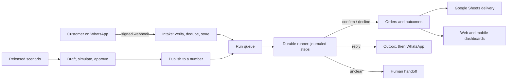
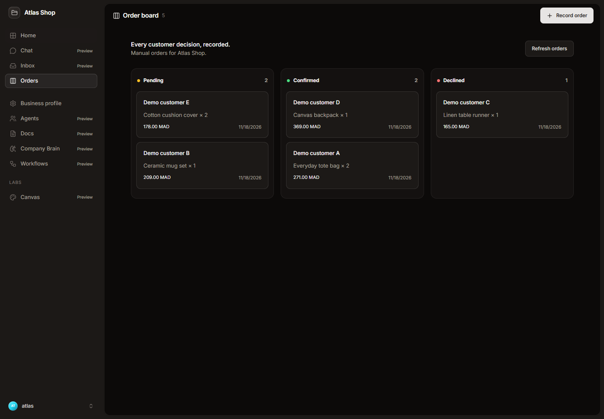
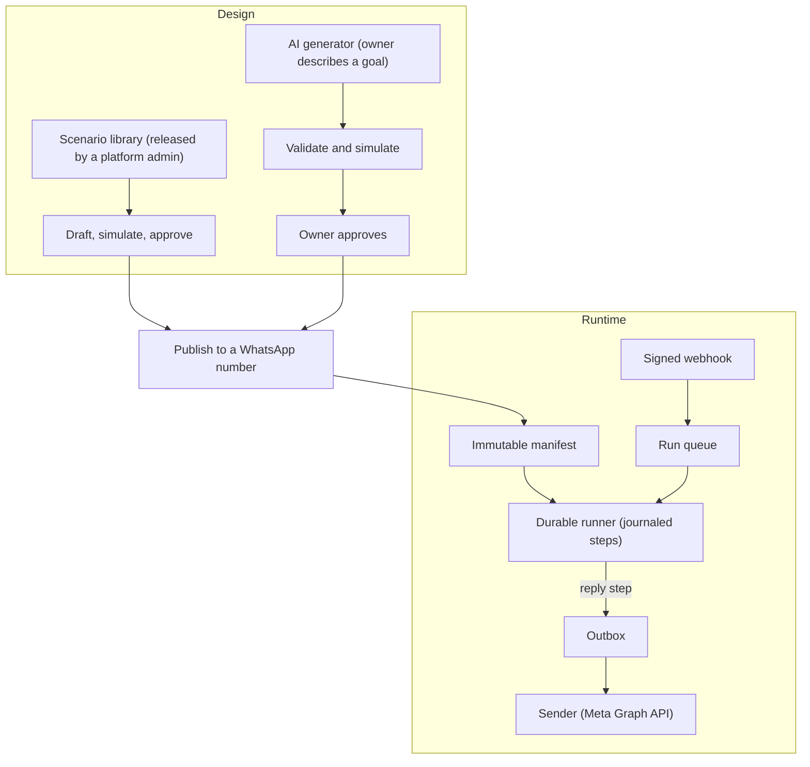

<div align="center">


### The open-source operations workspace for cash-on-delivery shops

Record orders, capture what customers confirmed, and let approved workflows
handle the repetitive replies, with a human always one step away.

<p>
  <a href="LICENSE"></a>
  <a href="package.json"></a>
  <a href="backend/package.json"></a>
  <a href="compose.yaml"></a>
  <a href="frontend/package.json"></a>
  
  <a href="https://github.com/Oumrane-Echidmi/SuperAgent/pulls"></a>
</p>

[Quick start](#quick-start) · [Features](#features) · [Automation guide](#automation-guide) · [How it works](#how-it-works) · [Screenshots](#demo--screenshots) · [API reference](docs/API.md) · [Developer guide](docs/DEVELOPMENT.md) · [Roadmap](#roadmap) · [Contributing](#contributing)

</div>

---

## Why SuperAgent

In cash-on-delivery commerce, the customer's "yes" is the contract. Shops lose
money when a confirmation lives only in a chat thread: the order is shipped,
the buyer refuses, and nobody can show what was actually agreed.

SuperAgent keeps one tenant-scoped record of **what was ordered, what the
customer confirmed, and what still needs a person**. A React web app, a Flutter
mobile client, and a TypeScript API share that record. Automation is opt-in,
reviewed before it goes live, and leaves a step-by-step audit trail.

The Inbox, Docs, Agents, Company Brain and Workflows screens persist business
data through the backend. The AI chat supports backend-configured model choices
and optional consent-based MCP reference tools. See [workspace behavior](WORKSPACE_FEATURES.md)
and [AI/MCP setup](AI_MCP.md).

> **Status: early and moving fast.** The order workspace, WhatsApp intake and
> replies, the scenario library, AI-generated workflows and the durable runtime
> work end to end in automated tests against a real database. Live Meta and
> OpenAI calls, a hosted deployment, and verified Android device runs are still
> ahead. See the [roadmap](#roadmap) and the [automation guide](#automation-guide).

## Features

| | |
| --- | --- |
| 🏪 **Business workspaces** | Registration, sign-in, owner/staff roles, business profiles, and tenant isolation enforced by PostgreSQL row-level security. |
| 📦 **COD order management** | Manual order entry, integer-centime pricing, saved summaries, and customer decisions bound to the exact reviewed revision. |
| 📊 **Daily outcomes** | Pending / confirmed / declined counts, confirmation rate, confirmed order value, and outstanding sheet sync. |
| 💬 **WhatsApp intake** | Signature-verified Meta Cloud API webhook, one number per business, deduplicated message storage. |
| 💬 **Replies** | Workflows answer customers on WhatsApp through a durable outbox with retries and backoff. |
| 🤖 **Reviewed automation** | Pick a released scenario, simulate it, approve the exact revision, then publish it to a number. Pause any time. |
| 📚 **Scenario library** | Order confirmation, support triage, appointment requests, and welcome / opt-out, ready to release. |
| ✨ **AI-generated workflows** | Describe a goal; the assistant builds a workflow from registered steps, which is simulated and needs your approval. It can never touch orders. |
| ⚙️ **Durable execution** | Every workflow step is journaled in the same transaction as its effect, so a crashed run resumes without repeating work. |
| 📄 **Google Sheets delivery** | Reviewed rows, explicit destination selection, queued jobs, and read-only reconciliation of uncertain outcomes. |
| 🧠 **Optional AI Builder** | Consent-based scenario matching and scoped chat through a separate worker, plus workflow generation. Off by default. |
| 🌍 **Built for Morocco** | French and Darija copy, MAD amounts, and Moroccan time zone defaults. |

**Principles:** a human can always take over · nothing publishes without an
approved revision · side effects are idempotent · secrets stay on the backend ·
every optional integration is off until configured.

## How it works



1. A customer replies to a pending order on WhatsApp.
2. The webhook verifies Meta's signature and stores the message once.
3. If a workflow is live on that number, a run is queued.
4. The runner executes the published manifest one node at a time. Clear replies
   ("oui", "نعم", "non merci") become a recorded confirmation or refusal;
   anything else is left for a person. Reply steps queue a WhatsApp message.
5. The order, its evidence, the reply, and the full run history appear in the clients.

The target design, including what is deliberately out of scope, is in
[ARCHITECTURE.md](ARCHITECTURE.md).

## Quick start

You need **Node.js 24+**, **Docker with Compose**, and **Git**.

```sh
git clone https://github.com/Oumrane-Echidmi/SuperAgent.git
cd SuperAgent
npm ci && npm --prefix frontend ci --ignore-scripts
cp backend/.env.example backend/.env        # then set two random passwords
docker compose --env-file backend/.env up -d --wait
npm run db:migrate
npm run dev                                  # API on http://127.0.0.1:3000
```

In a second terminal run `npm --prefix frontend run dev` and open
**http://127.0.0.1:4173**. Create a workspace, set the business profile, and
record your first order. No Google, OpenAI, or WhatsApp credentials are needed
for the basic workspace. Full setup, environment variables, and the Flutter
client are covered in [Getting Started](#getting-started).

## Contents

- [Features](#features) · [Automation guide](#automation-guide) · [How it works](#how-it-works) · [Quick start](#quick-start)
- [Demo / Screenshots](#demo--screenshots)
- [Tech Stack](#tech-stack)
- [Getting Started](#getting-started)
- [Automation guide](#automation-guide): capabilities, scenario library, replies, AI-generated workflows
- [Usage](#usage)
- [Project Structure](#project-structure)
- [Roadmap](#roadmap)
- [Contributing](#contributing) · [Security](#security) · [License](#license)

## Demo / Screenshots

These are actual local captures using synthetic shop and customer data. Mobile
images show the compiled Flutter web app at a phone viewport, not an Android
device run.

<!-- TODO: Add a public demo URL after a hosted deployment is available. -->

### Web workspace




### Mobile workspace

<p align="center">
  
  
</p>

## Tech Stack

| Layer | Technologies | Location |
| --- | --- | --- |
| Web | React 19, React Router 7, Vite 8, Lucide icons | [`frontend/`](frontend/) |
| Mobile | Flutter, Dart, HTTP client, timezone data | [`mobile flutter/`](mobile%20flutter/) |
| API | Node.js 24+, Express 5, TypeScript 5.9, Zod 4 | [`backend/src/`](backend/src/) |
| Database | PostgreSQL 18, SQL migrations, tenant row policies | [`backend/migrations/`](backend/migrations/) |
| Optional integrations | Google OAuth / Sheets, OpenAI-backed Builder, dedicated workers | [API reference](docs/API.md) |
| Verification | Node test runner, Playwright, Flutter unit/widget tests | [Testing guide](docs/DEVELOPMENT.md#testing-and-verification) |

## Getting Started

### Prerequisites

- **Git**, **Node.js 24 or newer**, and **npm**. The root package declares npm `11.20.0`.
- **Docker with Compose** for the supplied PostgreSQL service.
- **Flutter** for the mobile client. The recorded checks used Flutter `3.47.9` / Dart `3.13.7`; use an SDK compatible with the committed lockfile.
- **Android SDK/JDK and a device or emulator** only when building or running Android. Android APK/device verification is still pending.

No Google or OpenAI credentials are needed for the basic local order workspace.

### Installation

```sh
git clone https://github.com/Oumrane-Echidmi/SuperAgent.git
cd SuperAgent
npm ci
npm --prefix frontend ci --ignore-scripts
cp backend/.env.example backend/.env
```

On PowerShell, `Copy-Item backend/.env.example backend/.env` also works. If script
execution policy blocks npm, use `npm.cmd` in place of `npm`.

Edit `backend/.env` before starting the database. Generate separate random admin
and runtime passwords, then put the matching credentials in both database URLs.
Do not commit real environment files.

### Configuration

The full template is [`backend/.env.example`](backend/.env.example). Backend npm
scripts load `backend/.env`; Docker Compose receives it through `--env-file`.

| Variable | Purpose / local value | Required |
| --- | --- | --- |
| `POSTGRES_PASSWORD` | Password for the local `superagent_admin` database login | Local database |
| `APP_DATABASE_PASSWORD` | Separate password provisioned for the restricted API login | Migrations |
| `ADMIN_DATABASE_URL` | Admin connection to `superagent` on `127.0.0.1:5433`; use the admin password | Migrations |
| `DATABASE_URL` | Restricted `superagent_app` connection to the same database | API |
| `PORT` | API listen port; default `3000` | Optional |
| `BUILDER_AI_ENABLED` | `false` by default; explicitly enables AI Builder processing | Optional feature |
| `BUILDER_AI_MODEL`, `OPENAI_API_KEY` | Model selection and provider credential for the AI Builder worker | AI Builder |
| `BUILDER_WORKER_DATABASE_PASSWORD`, `BUILDER_WORKER_DATABASE_URL` | Separately provisioned Builder worker login; password must be at least 24 characters | AI Builder worker |
| `GOOGLE_CONNECTIONS_ENABLED` | `false` by default; enables Google OAuth connections | Optional feature |
| `GOOGLE_CLIENT_ID`, `GOOGLE_CLIENT_SECRET`, `GOOGLE_REDIRECT_URI` | Google OAuth client and exact registered callback URI | Google connections |
| `CREDENTIAL_ACTIVE_KEY_ID`, `CREDENTIAL_KEYS_JSON` | Active encryption key ID and JSON map of IDs to base64-encoded 32-byte keys | Google connections |
| `SHEETS_DELIVERY_ENABLED` | `false` by default; enables owner-authorized delivery | Sheets delivery |
| `SHEETS_WORKER_ENABLED` | `false` by default; enables the separate background delivery worker | Background delivery |
| `SHEETS_WORKER_DATABASE_PASSWORD`, `SHEETS_WORKER_DATABASE_URL` | Separately provisioned Sheets worker login; password must be at least 24 characters | Background delivery |
| `WHATSAPP_ACCESS_TOKEN`, `WHATSAPP_API_VERSION` | Meta system-user token and Graph API version (default `v21.0`); without the token replies stay queued | Outbound replies |
| `WORKFLOW_RUNNER_ENABLED` | `false` by default; runs queued WhatsApp workflow executions in the API process | Automated workflows |
| `WHATSAPP_ENABLED`, `WHATSAPP_APP_SECRET`, `WHATSAPP_VERIFY_TOKEN` | `false` by default; Meta app secret and webhook verify token (each at least 16 characters) | WhatsApp intake |

Keep optional flags disabled until their dependencies are configured. Provider
credentials belong on the backend. See the [API reference](docs/API.md) for worker
roles, consent, quotas, encryption keys, and connection lifecycle rules.

Client connection settings are separate from backend secrets:

| Setting | Where | Default |
| --- | --- | --- |
| `API_PROXY_TARGET` | React dev-server environment | `http://127.0.0.1:3000` |
| `SUPERAGENT_PROXY_TARGET` | Flutter local web-server environment | `http://127.0.0.1:3000` |
| `PORT` | Flutter local web-server environment | `8080` |
| `SUPERAGENT_API_URL` | Flutter compile-time `--dart-define` | Same-origin `/v1/` on web; `http://127.0.0.1:3000/v1/` on native |

### Run in development

From the repository root, start the database and API:

```sh
docker compose --env-file backend/.env up -d --wait
npm run db:migrate
npm run dev
```

The API listens on **http://127.0.0.1:3000**. PostgreSQL is exposed only on
loopback port `5433`. Migrations use the administrative connection; the API
refuses privileged runtime credentials.

In a second terminal, from the repository root:

```sh
npm --prefix frontend run dev
```

Open **http://127.0.0.1:4173**. Vite proxies API requests to the backend.

For the Flutter phone layout, open another terminal from the repository root:

```sh
cd "mobile flutter"
flutter pub get
flutter build web --release --no-web-resources-cdn
node tool/serve-web.mjs
```

Open **http://127.0.0.1:8080**. The local server serves the compiled app and proxies
`/v1/` to the API. See the [mobile guide](mobile%20flutter/README.md#android) for
native Android setup and `adb reverse`.

### Production builds

Build and start the compiled backend from the repository root with a migrated
database and valid runtime configuration:

```sh
npm run build
npm start --workspace backend
```

Build the React static assets separately:

```sh
npm --prefix frontend run build
```

This produces `backend/dist/` and `frontend/dist/`. The API still binds to
loopback. Hosting the connected web app requires static serving, SPA fallback,
HTTPS, and a same-origin `/v1/` reverse proxy. Vite's local preview server does
not supply the development API proxy. The Flutter release build and nginx proxy
are documented in the [mobile Docker guide](mobile%20flutter/README.md#docker-web-build).

<!-- TODO: Add deployment-specific hosting, HTTPS/reverse-proxy, secret-management, and process/worker instructions once a production target is selected. -->

## Automation guide

This section is the reference for everything that talks to customers. It is
written for contributors: it explains what exists, why it works the way it does,
and where the edges are.

### Overview



A workflow is a graph of **capabilities**: versioned, typed building blocks
registered in [`backend/src/capabilities.ts`](backend/src/capabilities.ts). The
engine never runs model-written code; a generated or released workflow can only
wire registered capabilities together.

### Capabilities

| Capability | Kind | What it does | Side effect |
| --- | --- | --- | --- |
| `whatsapp.message` | trigger | Starts a run from an inbound text message; outputs `text` and `customerPhone`. | none |
| `cod.text.intent` | condition | Routes `match` when the text is an exact confirm or decline phrase (oui, نعم, non merci, …). | none |
| `text.keywords` | condition | Routes `match` when the text contains any whole-word keyword from a comma-separated list. | none |
| `text.equals` / `text.copy` / `manual.text` | utility | Exact comparison, copy, and manual-test trigger. | none |
| `cod.order.confirm` / `cod.order.decline` | action | Records the customer's decision on the pending order, bound to its reviewed revision. | **orders** |
| `whatsapp.reply` | action | Queues a text reply to the customer who wrote. | **messages** |
| `workflow.end` | end | Finishes the run with a reason shown in run history. | none |

Every capability declares a `risk` (`none`, `orders`, `messages`) and an
`idempotency` mode (`pure` or `keyed`). Adding one means: define the contract
and fixtures, implement it (pure adapters in `capabilities.ts`, real effects in
[`workflow-runtime.ts`](backend/src/workflow-runtime.ts)), and add tests.

### Scenario library

Ready-made scenarios live in [`backend/examples/scenarios/`](backend/examples/scenarios/).
Each one passes validation and simulation with every edge covered
(`backend/tests/scenario-library.test.ts`).

| Scenario | Use case | Behaviour |
| --- | --- | --- |
| `cod-confirmation-replies` | Order confirmation | Confirms or declines the pending order from the customer's reply and answers in French and Darija. Unclear replies go to a person. |
| `support-triage` | Customer support | Acknowledges every message; gives a more specific holding note for price and delivery questions. Never invents answers. |
| `appointment-requests` | Appointments | Detects a booking request, asks for day, time and name, and ends the run as "Appointment requested" for staff to confirm. |
| `welcome-and-opt-out` | Marketing hygiene | Greets new messages and honours STOP / arrêt / إلغاء with a confirmation. |

`cod-confirmation-scenario.json` in `backend/examples/` is the original,
reply-less variant kept for tests.

Release them as a platform admin (the user must exist and be an admin; see
`npm run admin:grant`):

```sh
npm --prefix backend run scenarios:seed -- admin@example.com
```

The script validates and simulates each file before inserting it and skips
scenarios that are already released.

> **Limits.** The marketing scenario handles consent words only. There is no
> blocklist that suppresses later messages and no broadcast or campaign
> sending. Appointments are *requests*: there is no calendar or availability
> check. Reply texts are fixed bilingual literals; edit the JSON to change them.

### Outbound WhatsApp replies

A `whatsapp.reply` step never calls Meta itself. It records the message in the
`whatsapp_outbox` table inside the same transaction as its step journal entry.
A separate sender loop then delivers it. This keeps network calls out of
database transactions and makes retries safe.

| Guarantee | How |
| --- | --- |
| A replayed step cannot queue a second message | `UNIQUE (tenant_id, run_id, node_id)` on the outbox |
| Delivery is at-least-once | A claimed message holds a 120-second lease; a crashed sender's message is retried |
| Transient failures retry with backoff | Network errors, HTTP 429 and 5xx re-queue after 15 s × attempts |
| Permanent failures stop at once | Other 4xx (bad token, closed window, invalid number) mark the message `FAILED` |
| Retries are bounded | After 5 attempts the message is `FAILED` (`RETRIES_EXHAUSTED`) |

Because delivery is at-least-once, a crash between Meta accepting a message
and the database recording it can send that reply twice. That is the standard
trade-off without provider-side idempotency keys.

**Setup**

1. In Meta's developer dashboard, create a system-user access token with the
   `whatsapp_business_messaging` permission.
2. Set `WHATSAPP_ACCESS_TOKEN` (and optionally `WHATSAPP_API_VERSION`, default
   `v21.0`) in `backend/.env`, plus `WORKFLOW_RUNNER_ENABLED=true`.
3. Restart the API. The sender starts only when the token is present; without
   it replies stay `QUEUED`, visible on the WhatsApp page.

Replies are free-text messages, which WhatsApp allows within 24 hours of the
customer's last message. Every reply here answers an inbound message, so it
is always inside that window. Template messages (needed to start a
conversation) are not implemented.

### AI-generated workflows

When no released scenario fits, an owner can describe a goal and let the
assistant build a workflow ([`workflow-generator.ts`](backend/src/workflow-generator.ts),
[`generated-workflow-routes.ts`](backend/src/generated-workflow-routes.ts)).

1. **Describe.** `POST /v1/tenants/:id/generated-workflows` with a goal,
   language and explicit consent to send it to OpenAI. Subject to the daily
   Builder quota.
2. **Generate.** The model receives the goal as untrusted data, the catalog of
   *allowed* capabilities and the wiring rules, and returns a workflow plus 2–10
   test fixtures.
3. **Validate.** The result goes through the same structural checks, binding
   checks and simulator as released scenarios. Every edge must be exercised by
   a fixture. Invalid output is stored with its reasons so the owner sees why.
4. **Review and approve.** The owner reads the steps and reply texts and
   approves the exact result. Approval is one-way and the workflow is immutable
   afterwards.
5. **Publish.** `POST /v1/tenants/:id/publications` with `generatedWorkflowId`.
   It is re-validated at publication time.

**Safety rules, enforced in code (not in the prompt)**

- Generated workflows may **not** use capabilities with `orders` risk. Recording
  a customer's confirmation stays in human-authored, admin-released scenarios.
- Only registered capabilities and versions are accepted; anything else is
  rejected by validation.
- Exactly one `whatsapp.message` trigger is required.
- Nothing runs until the owner approves; only owners can generate, approve or
  publish.
- The model call happens outside any database transaction and its failures are
  reported as a generic `GENERATION_FAILED`.

Needs `BUILDER_AI_ENABLED=true`, `OPENAI_API_KEY` and `BUILDER_AI_MODEL`.
Generation is **not** deterministic; always read the preview.

### End-to-end walkthrough

1. Start the stack ([Getting Started](#getting-started)) with
   `WHATSAPP_ENABLED=true`, `WHATSAPP_APP_SECRET`, `WHATSAPP_VERIFY_TOKEN`,
   `WHATSAPP_ACCESS_TOKEN` and `WORKFLOW_RUNNER_ENABLED=true`.
2. Release the library: `npm --prefix backend run scenarios:seed -- you@example.com`.
3. In the web app open **WhatsApp** and register your phone number ID.
4. Open **Builder**, create a draft from *Customer support triage*, then
   **Simulate**, **Approve**, and **Publish** it to your number.
5. In Meta's dashboard point the webhook at
   `https://<your-host>/v1/webhooks/whatsapp` using your verify token.
6. Message your business number. The run appears under *Recent runs* and the
   reply under *Replies sent by workflows*.

For COD confirmation, first record an order and keep it pending, using the
customer's phone number as the conversation reference. Then publish
*COD confirmation with replies*.

### API summary

| Endpoint | Who | Purpose |
| --- | --- | --- |
| `POST /v1/webhooks/whatsapp` · `GET` | Meta | Signed inbound messages; webhook verification |
| `POST/GET /v1/tenants/:id/whatsapp-numbers` | owner / member | Register and list numbers |
| `GET /v1/tenants/:id/whatsapp-messages` · `whatsapp-outbox` | member | Inbound messages; queued and sent replies |
| `POST/GET /v1/tenants/:id/generated-workflows` · `/:id` · `/:id/approve` | owner | Generate, review, approve |
| `POST/GET /v1/tenants/:id/publications` · `/:id/pause` · `/:id/resume` | owner | Publish a draft or generated workflow to a number |
| `GET /v1/tenants/:id/workflow-runs` · `/:id` | member | Run history with every journaled step |

Request and error details are in the [API reference](docs/API.md).

### Known limitations

- Replies are plain text only: no templates, media, buttons or lists.
- Orders are still created by staff. Incoming messages do not create orders.
- Intent detection is exact-phrase. A long or mixed message always goes to a
  person, which is deliberate but conservative.
- One live workflow per WhatsApp number; one Meta access token for the server.
- The runner and sender run inside the API process. Run a single API instance
  or accept that leases (not a separate scheduler) coordinate several.

## Usage

### Record and review an order

1. Open either connected client and create a workspace or sign in.
2. Set the shop language, timezone, and description under **Business profile**.
3. Open **Orders**, select **Record order**, and enter customer, item, pricing,
   and delivery details.
4. Review the saved summary. Record customer evidence before choosing a decision.
5. Return to Home to view outcomes for orders started today in the saved business
   timezone. Confirmed value represents purchase value, not cash collected.

Sessions stay in memory in both current clients; refreshing requires signing in
again. Spreadsheet delivery requires a configured Google connection/destination
and an explicit owner action.

### Call the API

From the repository root, check liveness and validate the included workflow
without creating business records:

```sh
curl http://127.0.0.1:3000/healthz

curl -X POST http://127.0.0.1:3000/v1/workflow-validations \
  -H "Content-Type: application/json" \
  --data-binary @backend/examples/typed-workflow.json
```

The health endpoint returns:

```json
{ "status": "ok" }
```

`/healthz` checks process liveness, not database readiness. The curl examples use
POSIX shell syntax; on PowerShell use `curl.exe` and PowerShell line continuation
or place each command on one line.

For authenticated requests, registration, tenant scoping, order payloads, errors,
and retry semantics, use the [API reference](docs/API.md). The
[developer guide](docs/DEVELOPMENT.md#where-to-change-code) maps each feature to
its backend handlers, domain rules, migrations, tests, and both clients.

### Run checks

From the repository root:

```sh
npm test
npm run typecheck
npm run build
npm --prefix frontend test
npm --prefix frontend run build
```

Database integration and Playwright suites require a dedicated migrated
`superagent_test` database. Flutter has separate unit, widget, analysis, and live
API checks. Follow the [testing guide](docs/DEVELOPMENT.md#testing-and-verification)
for setup and isolation requirements. Existing tooling findings and Android
verification limits are recorded in the [web guide](frontend/README.md) and
[mobile verification log](mobile%20flutter/docs/VERIFICATION.md).

## Project Structure

```text
SuperAgent/
├── backend/
│   ├── src/             # Express routes, domain logic, providers, workers
│   ├── migrations/      # Numbered PostgreSQL migrations and row policies
│   ├── scripts/         # Database setup, migrations, admin and cleanup tools
│   ├── examples/        # JSON requests and workflow fixtures
│   └── tests/           # Unit, HTTP protocol and database integration tests
├── frontend/
│   ├── src/             # React pages, components, API context and styles
│   └── tests/           # Unit tests and Playwright browser scenarios
├── mobile flutter/
│   ├── lib/account/     # HTTP transport, sessions and tenant scope
│   ├── lib/workspace/   # Connected Home, Orders and profile screens
│   ├── android/         # Android project and debug network configuration
│   ├── web/             # Flutter web shell
│   ├── assets/          # Fonts and bundled licenses
│   ├── test/            # Flutter unit and widget tests
│   └── tool/            # Web proxy and live API/browser checks
├── docs/                # API reference, developer guide and screenshots
├── compose.yaml         # Local PostgreSQL service
├── ARCHITECTURE.md      # Target architecture and release boundaries
└── LICENSE              # MIT license
```

## Roadmap

Shipped:

- [x] Business identity, profiles, manual orders, and outcomes on web and mobile.
- [x] Reviewed customer decisions and explicit Google Sheets delivery.
- [x] Capability validation, scenario releases, draft simulation and approval.
- [x] Web screens for the Builder, scenario catalog, and Google connections.
- [x] Signature-verified WhatsApp intake with per-business number registration.
- [x] COD workflow actions, publication to a number, and journaled durable execution (`WORKFLOW_RUNNER_ENABLED=true`).
- [x] Outbound WhatsApp replies through a durable outbox with retries ([guide](#outbound-whatsapp-replies)).
- [x] Scenario library: confirmation with replies, support triage, appointments, welcome / opt-out ([guide](#scenario-library)).
- [x] AI-generated workflows with validation, simulation and owner approval ([guide](#ai-generated-workflows)).
- [x] Web screens for WhatsApp numbers, messages and replies, and for generating workflows.

Next (contributions welcome):

- [ ] WhatsApp template messages, media and interactive buttons (replies are plain text today).
- [ ] Verify against live Meta and OpenAI accounts; none of the provider calls has run against the real services yet.
- [ ] Opt-out blocklist, broadcast campaigns, and calendar-backed appointments.
- [ ] Create order attempts from incoming messages instead of staff entry.
- [ ] Flutter screens for the Builder, Google connections, and workflow runs.
- [ ] Web screens for WhatsApp numbers and inbound messages.
- [ ] Android device verification (a debug APK builds; no device run is recorded yet).
- [ ] Hosted deployment guide: HTTPS reverse proxy, secret management, worker processes.
- [ ] A public demo.

Have an idea? [Open an issue](https://github.com/Oumrane-Echidmi/SuperAgent/issues).

## Contributing

1. Fork the repository and create a focused branch from `main`.
2. Follow the [developer guide](docs/DEVELOPMENT.md) to find the affected code and
   contracts. Keep API changes, both clients, examples, and documentation aligned.
3. Run the relevant checks above. Use synthetic data and a dedicated test database.
4. Commit a focused change and open a pull request against `main`, describing
   the behavior change, validation results, and any limitations.

Keep secrets out of commits. Preserve tenant authorization, revision checks,
idempotent retries, and provider reconciliation rules described in
[backend security](backend/SECURITY.md) and the [API reference](docs/API.md).

## Security

Tenant isolation, revision checks, idempotent retries, and provider
reconciliation are core invariants. Please **do not open public issues for
vulnerabilities**: report them privately through GitHub's
[security advisories](https://github.com/Oumrane-Echidmi/SuperAgent/security/advisories/new).
The threat model is in [backend/SECURITY.md](backend/SECURITY.md).

## License

Distributed under the [MIT License](LICENSE). Copyright © 2026 oumrane echidmi,
as recorded in the license file. Bundled font licenses remain with their assets.

## Contact / Acknowledgments

Built by the SuperAgent team. Special thanks to:

- [Oumrane Echidmi · @Oumrane-Echidmi](https://github.com/Oumrane-Echidmi)
- [Salah Makboul · @salahmakboul](https://github.com/salahmakboul)

For code changes, open a pull request in the
[SuperAgent repository](https://github.com/Oumrane-Echidmi/SuperAgent).
