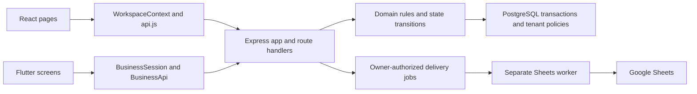

# Developer guide

[Project overview](../README.md) · [API reference](API.md) · [Architecture](../ARCHITECTURE.md)

This guide covers implemented code. The architecture document also describes
future capabilities; check the API reference and client routes before assuming a
planned feature is available.

## Repository map

```text
backend/
  src/             HTTP routes, domain rules, provider adapters, workers
  migrations/      Numbered SQL migrations and tenant/service role policies
  scripts/         Migration, test database, admin, and cleanup commands
  examples/        JSON request and workflow examples
  tests/           Unit, HTTP protocol, and PostgreSQL integration tests
frontend/
  src/pages/       Connected React pages and labelled previews
  src/context/     Identity, tenant selection, and request lifecycle
  src/lib/         Browser API and money helpers
  tests/           Unit tests and real-backend Playwright scenarios
mobile flutter/
  lib/account/     API URL, HTTP transport, in-memory sessions, tenant scope
  lib/workspace/   Connected Flutter screens and order/delivery forms
  lib/main.dart    Authentication gate and connected routes
  lib/theme.dart   Design tokens, shared widgets, workspace drawer
  test/            Unit and widget tests
  tool/            Local web proxy and live API/browser checks
docs/
  API.md           Endpoint contracts and operational limits
  screenshots/     README screenshots using synthetic data
```

## How a request reaches the database



The web dev server and Flutter web server proxy `/v1/` to the API. Native Flutter
uses `SUPERAGENT_API_URL`. Business requests include a bearer session and tenant
ID. The backend enforces membership and role checks; hiding a client button is
not authorization.

[`server.ts`](../backend/src/server.ts) validates configuration and database roles,
then starts [`app.ts`](../backend/src/app.ts). The app installs bounded JSON
parsing, security headers, routers, and the shared error handler.
[`database.ts`](../backend/src/database.ts) supplies transactions and authenticated
tenant context. SQL migrations define corresponding row policies and grants.

## Where to change code

| Change | Backend entry points | Clients / supporting code |
| --- | --- | --- |
| Identity and profile | [`identity-routes.ts`](../backend/src/identity-routes.ts), [`auth.ts`](../backend/src/auth.ts), [`database.ts`](../backend/src/database.ts) | React `WorkspaceContext.jsx`, `SignInPage.jsx`, `BusinessProfilePage.jsx`; Flutter `lib/account/`, `sign_in.dart`, `profile.dart` |
| Orders, totals, decisions | [`cod-routes.ts`](../backend/src/cod-routes.ts), [`cod.ts`](../backend/src/cod.ts), [`cod-store.ts`](../backend/src/cod-store.ts) | React `OrdersPage.jsx`, `NewOrderPage.jsx`, `OrderDetailsPage.jsx`; Flutter `orders.dart`, `new_order.dart`, `order_details.dart`, `order_values.dart` |
| Daily outcomes | [`cod-dashboard.ts`](../backend/src/cod-dashboard.ts) | React `LiveHomePage.jsx`; Flutter `home.dart`; use the saved business timezone |
| Graphs and capabilities | [`compiler.ts`](../backend/src/compiler.ts), [`workflow-compiler.ts`](../backend/src/workflow-compiler.ts), [`capabilities.ts`](../backend/src/capabilities.ts), [`workflow-routes.ts`](../backend/src/workflow-routes.ts) | [`simulator.ts`](../backend/src/simulator.ts), JSON examples, compiler and capability tests |
| Admin scenarios | [`scenario-routes.ts`](../backend/src/scenario-routes.ts), [`scenario-contracts.ts`](../backend/src/scenario-contracts.ts) | Scenario fixtures, immutable releases, platform-admin checks |
| Tenant drafts | [`builder-routes.ts`](../backend/src/builder-routes.ts), [`builder.ts`](../backend/src/builder.ts) | Draft revision, simulation, approval tables and integration tests |
| Matching and AI chat | [`matching-routes.ts`](../backend/src/matching-routes.ts), [`matching.ts`](../backend/src/matching.ts), [`builder-chat-routes.ts`](../backend/src/builder-chat-routes.ts), [`openai-builder.ts`](../backend/src/openai-builder.ts) | Builder workers, consent, quota, queued request lifecycle |
| Google connection | [`google-connection-routes.ts`](../backend/src/google-connection-routes.ts), [`google-oauth.ts`](../backend/src/google-oauth.ts), [`credentials.ts`](../backend/src/credentials.ts) | Maintenance scripts, encrypted envelopes, Google protocol tests |
| Sheet destinations | [`sheet-destination-routes.ts`](../backend/src/sheet-destination-routes.ts), [`google-access.ts`](../backend/src/google-access.ts) | Immutable file/tab bindings and access checks |
| Reviewed delivery | [`sheet-delivery-routes.ts`](../backend/src/sheet-delivery-routes.ts), [`sheet-delivery.ts`](../backend/src/sheet-delivery.ts), [`sheet-execution.ts`](../backend/src/sheet-execution.ts) | React `DeliveryPanel.jsx`; Flutter `sheet_delivery.dart`; pinned row and reconciliation |
| Background delivery | [`sheet-job-routes.ts`](../backend/src/sheet-job-routes.ts), [`sheet-job-worker.ts`](../backend/src/sheet-job-worker.ts), [`sheet-worker.ts`](../backend/src/sheet-worker.ts) | Worker role, leases/fences, explicit dispatch authorization |
| Navigation and layout | No API change needed for navigation alone | React `App.jsx`, `Sidebar.jsx`, `styles/`; Flutter `main.dart`, `theme.dart`, `lib/workspace/` |

React pages are under `frontend/src/pages/`, context under `frontend/src/context/`,
and components under `frontend/src/components/`. Flutter screen names are under
`mobile flutter/lib/workspace/` unless otherwise stated. Old Flutter `lib/screens/`
and `lib/cod/` sources remain in the repository but are not imported by connected
app routes. Its menu contains only Home, Orders, and Business profile.

## Example: add an order field

1. Define whether the field is customer-supplied evidence or shop-owned data.
   Update the strict schema and domain validation in `cod.ts` and the relevant
   handler in `cod-routes.ts`.
2. Update storage/review behavior in `cod-store.ts`. If database structure,
   constraints, permissions, or policies change, add the next numbered migration.
   Keep migrations already applied to shared databases immutable.
3. Check whether it changes the summary, hash, total, or confirmed snapshot.
   A decision must still refer to exactly what was reviewed.
4. Update both clients' forms and detail screens, JSON examples, and the API
   reference. Keep money as integer centimes across the boundary.
5. Cover validation/state transitions with focused tests, then run affected
   PostgreSQL integration and client flows with synthetic data.

Spreadsheet projections are a separate fixed-schema contract. Adding an order
field does not automatically add a column to existing spreadsheets.

## Contract rules to preserve

- Keep tenant and role checks in backend/database policies. A client-supplied
  tenant ID or role is not proof of authorization.
- Current browser and Flutter sessions stay in memory. Keep tokens, passwords,
  provider credentials, and real environment files out of source and screenshots.
- Retain creation/decision/job UUIDs and payloads after uncertain responses.
  Retries must not create new business actions.
- Reviewed revisions/hashes are concurrency boundaries. A `409` requires rereading
  and review, not silently forcing a stale decision.
- Preserve `UNKNOWN` provider outcomes and use read-only reconciliation. Do not
  issue another append to make a test pass.
- Keep errors safe and structured. Update [API.md](API.md), examples, and matching
  tests whenever an endpoint contract changes.

## Configuration and migrations

Copy [`backend/.env.example`](../backend/.env.example) for local development.
Keep administrative migration credentials separate from API and worker logins.
The API refuses a privileged runtime role. The local database is `superagent`;
the integration suite requires `superagent_test`.

```sh
# Repository root; applies numbered migrations once
npm run db:migrate

# Compile and run the backend
npm run build
npm start --workspace backend
```

Provider features are opt-in. Builder AI uses `BUILDER_AI_ENABLED` and a dedicated
configuration/worker. Google requires an OAuth client, exact redirect URI, vault
keys, and `GOOGLE_CONNECTIONS_ENABLED`. Sheets dispatch also requires
`SHEETS_DELIVERY_ENABLED`; background dispatch additionally requires
`SHEETS_WORKER_ENABLED` and its provisioned database role. Follow the
[API reference](API.md) for setup and lifecycle details. Restart affected processes
after changing environment variables.

## Testing and verification

Run commands from the repository root unless a directory change is shown.

| Scope | Commands | Database / effects |
| --- | --- | --- |
| Backend unit / protocol | `npm test` | No PostgreSQL required |
| Backend types / build | `npm run typecheck`, `npm run build` | No provider calls |
| Backend integration | `npm run test:integration` | Dedicated migrated `superagent_test` |
| React unit / build | `npm --prefix frontend test`, `npm --prefix frontend run build` | No live providers |
| React browser | `npm --prefix frontend run test:e2e` | Dedicated test database, isolated API/browser |
| Flutter unit / widget | `flutter test` inside `mobile flutter` | Fixture transport |
| Flutter live API | `flutter test tool/live_api_test.dart` inside `mobile flutter` | Creates synthetic accounts/orders in configured development API |
| Flutter browser | `node tool/browser-smoke.mjs` inside `mobile flutter` | Local API and compiled app; creates synthetic data |

For database integration, copy `backend/.env.test.example` to `backend/.env.test`,
configure local role passwords with both URLs pointing to `superagent_test`, then:

```sh
npm run db:setup:test --workspace backend
npm run test:integration
```

Do not overlap backend integration with React browser tests: they share the test
database and rate-limit counters. Browser installation and fixture cleanup are
documented in the [web guide](../frontend/README.md#verification).

For connected Flutter checks:

```sh
cd "mobile flutter"
flutter test
flutter analyze lib/account lib/workspace lib/main.dart lib/theme.dart test tool/live_api_test.dart
flutter build web --release --no-web-resources-cdn
```

The [mobile verification log](../mobile%20flutter/docs/VERIFICATION.md) distinguishes
fixture, real-backend, browser, and unverified Android checks. Full analysis also
includes retained legacy demo sources and their existing findings.

## Local troubleshooting

| Symptom | Check |
| --- | --- |
| API cannot start | Database health, URL passwords, migrations, runtime role |
| Web `/v1/` fails | API on port 3000 and Vite proxy target; production needs an equivalent proxy |
| Flutter web cannot connect | Build and run `tool/serve-web.mjs` on 8080; a separate Flutter dev origin needs a proxy |
| Android localhost fails | `adb reverse tcp:3000 tcp:3000`, debug loopback configuration, or HTTPS `SUPERAGENT_API_URL` |
| `401` after refresh | Sessions are intentionally memory-only; sign in again |
| Repeated tests hit `429` | Auth permits 10 attempts per IP/email per 15 minutes; wait for the window rather than weakening limits |
| Spreadsheet unavailable | Provider flags, connected destination, owner access, worker configuration; disabled features return errors |

## Updating screenshots

Use an isolated local workspace with synthetic accounts, customer details, and
orders. Capture React at a desktop viewport and the compiled Flutter app at a
phone viewport. Replace the four PNGs in `docs/screenshots/` and inspect them for
stale UI, clipping, and sensitive data. Flutter web screenshots demonstrate phone
layout; they are not Android device verification.
